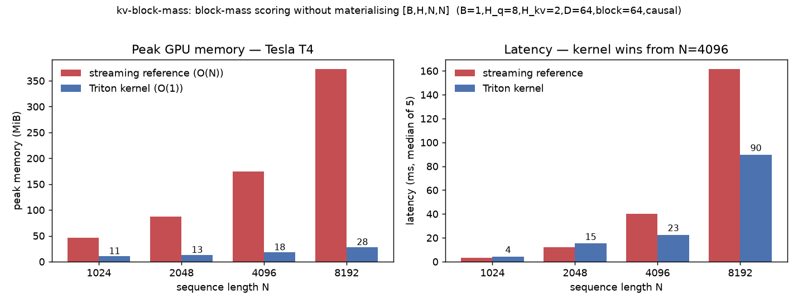

# kv-block-mass

[](https://github.com/aidless/kv-block-mass/actions/workflows/ci.yml)

**Block-granular attention mass in O(N) memory — reference + Triton kernels, cross-vendor (CUDA / ROCm).**

Companion of [`aidless/paged-kv`](https://github.com/aidless/paged-kv): paged-kv manages block
*lifetimes* (refcount / COW / failure-side-effect-free bookkeeping). This repo computes
*which blocks deserve to live* — the per-block attention-mass scores used by KV-eviction
research (H2O / SnapKV style) — **without materializing the `[B, H, N, N]` softmax matrix**.

That matrix is the reason H2O-style scoring gives up FlashAttention: for N=4096, one layer,
fp32, it is 512 MiB **per head per batch**. We stream over query chunks and scatter-add column
sums into `num_blocks` buckets, so peak memory is `O(B·H·chunk·N)` for the reference and one
score tile for the Triton kernel.

## Install & reproduce

```bash
pip install -e .                # only dependency: torch>=2.0 (CPU wheel is enough for the reference)
pip install -e ".[test]"        # + pytest
pytest tests/ -q                # full suite; tests/test_triton.py needs a CUDA/ROCm device
python examples/policy_card.py  # end-to-end: design -> certificate -> byte card, one command
```

Verified 2026-11-10 on a clean checkout: `pytest tests/ -q --ignore=tests/test_triton.py`
→ **55 passed** (the excluded file is the GPU-only kernel-agreement suite); the example
prints a card with `kept_fraction 0.2461` and `as_stored_frac 1.0005` — the 24.6%-of-tokens
/ 100.05%-of-cache headline below, straight from the code.

The benchmark figure below is regenerated from the committed JSON, not retyped:

```bash
python3 docs/make_bench_figure.py   # reads bench/bench_cuda_T4_20261031.json -> docs/figures/
```

## What it computes

```
mass[j] = Σ_{b,h,i, j_pos ∈ block j} softmax_j( q_i · k_j · scale )
```

- `q: [B, H_q, N, D]`, `k: [B, H_kv, N, D]` — GQA supported (`H_q % H_kv == 0`)
- causal and arbitrary `attn_mask` (`[N]` column or `[N, N]` pair mask)
- **sum rule**: every unmasked query row distributes exactly 1.0 over keys, so
  `Σ mass == B · H_q · N` — this identity is a test, not a hope
- fully-masked rows contribute exactly 0 (no NaN leakage)

## Results

All numbers measured (not projected), 2026-10-31. Shapes: B=1, H_q=8, H_kv=2, D=64,
block_size=64, causal; median of 5; memory = `torch.cuda.max_memory_allocated`.

**Tesla T4** (Kaggle, torch 2.11.0+cu128, Triton 3.6.0 — `bench/bench_cuda_T4_20261031.json`):

| N | dense O(N²) MiB | reference ms | reference MiB | triton ms | triton MiB | rel err |
|---|---|---|---|---|---|---|
| 1024 | 110 | 3.47 | 47 | 4.26 | 11 | 2.2e-6 |
| 2048 | 405 | 12.32 | 87 | 15.19 | 13 | 3.0e-6 |
| 4096 | — | 40.18 | 174 | **22.59** | 18 | 7.5e-6 |
| 8192 | — | 161.34 | 372 | **89.76** (1.8×) | **28** (13× less) | 1.5e-5 |



*Peak memory (left) and latency (right) on Tesla T4, plotted from
`bench/bench_cuda_T4_20261031.json` by `docs/make_bench_figure.py`: the kernel's
footprint is flat in N (one score tile) while the streaming reference grows linearly,
and the kernel wins on speed from N=4096.*

**AMD Radeon W7900-class (gfx1100)** (ROCm 7.2, torch 2.14.1+rocm7.2, Triton 3.5.1/HIP —
`bench/bench_rocm_20261031T172739Z.json`):

| N | dense O(N²) MiB | reference ms | reference MiB | triton ms | triton MiB | rel err |
|---|---|---|---|---|---|---|
| 1024 | 134 | 1.06 | 71 | 10.42 | 35 | 3.4e-6 |
| 2048 | 429 | 2.41 | 111 | 25.01 | 37 | 3.2e-6 |
| 4096 | — | 7.67 | 198 | 49.56 | 42 | 7.9e-6 |
| 8192 | — | 59.39 | 396 | 137.41 | **52** (7.6× less) | 1.6e-5 |

Honest reading, both directions:

- **Memory**: the Triton kernel's footprint grows O(1) in N (one 64×64 tile) while the
  streaming reference grows linearly (chunk×N score buffer) — 13× less at N=8192 on T4.
  The dense O(N²) baseline that H2O-style scoring normally pays is 429 MiB at N=2048
  *for this tiny shape* and grows quadratically from there.
- **Speed**: on T4 the kernel wins from N=4096 (1.8× at 8192). On RDNA3/HIP it does not —
  the 64×64 `input_precision="ieee"` dot compiles poorly on gfx1100, so the PyTorch
  streaming reference (rocBLAS-backed) is faster there. We report both rather than
  benchmarking only the GPU that flatters the kernel. Tuning (BLOCK sizes, fewer
  atomics, fp16 accumulation experiments) is open work.

Causal early exit (`causal_skip`, on by default): under a causal mask, key columns past a
query block's **last** row are masked for every row of that block, so they contribute exactly
0 and are never touched. Reproduced on CPU (torch 2.14.1, 8 threads, streaming reference,
`query_chunk=256`, median of 3, `bench/bench_causal_skip.py`): N=2048 **103.3 → 38.7 ms
(2.67×)**, N=4096 **259.3 → 109.7 ms (2.36×)**, output **bit-identical** (max relative
diff 0.0e+00). Absolute wall-clock varies with machine load; the **~2.4–2.8× speedup and
the bit-identical output are the stable claims** (an earlier measurement on the same
machine gave 291.2→123.5 ms / 1417.2→496.0 ms, same conclusion). The Triton kernel applies
the same bound as a dynamic loop trip count. The bound is mutation-tested:
`EARLY_EXIT_TOO_TIGHT` (using the block's first row instead of its last, which silently
drops the diagonal block) is one of the four injections the oracle must catch.

Correctness across backends: Triton-vs-reference agreement ≤ 1.6e-5 max relative error
on both CUDA and ROCm; the fp64 dense oracle agrees to ~1e-6 on every bucket.

Two independent T4 runs are archived: `bench/bench_cuda_T4_20261031.json` (worker v5,
numbers recovered from stdout after the final write hit Kaggle's read-only FS) and
`bench/bench_cuda_T4_v6_final.json` (worker v6, status COMPLETE, code at commit 278d479).
They agree within run-to-run noise — e.g. N=8192 triton 89.8 vs 91.6 ms, 28 MiB both.

## What this proves — and what it does not

**This repo proves:**

- `block_mass_reference` computes block-pooled column sums of the softmax attention
  matrix without materializing `[B, H, N, N]`, and the streaming reference is **exactly
  equivalent** to the dense oracle: every unmasked query row distributes 1.0 over keys,
  so `Σ mass == B · H_q · N` holds (tested, not hoped), and fully-masked rows contribute
  exactly 0 with no NaN leakage.
- The Triton kernel agrees with the reference to ≤ 1.6e-5 max relative error on CUDA
  (T4) and ROCm (gfx1100), at the memory/throughput numbers tabulated above.
- The mutation gate (`tests/mutation_gate.py`) proves the dense-oracle comparison
  **catches** real bugs — dropped causality, missing softmax denominator, bucket
  off-by-one, and an over-tight causal early-exit bound all fail loudly (max errors
  3.5e2–2.6e5 vs control ~1e-13). Correlation alone would not: the predecessor `kvfrag`
  incident showed Pearson r > 0.999 with relative error ~0.2.

**This repo does *not* prove:**

- That block-level attention mass is a **good eviction policy** for any serving stack.
  It computes scores; whether those scores improve generation quality/latency is a
  separate question this repo does not answer (the companion `aidless/paged-kv`
  handles block lifetimes; policy evaluation is outside both).
- That the Triton kernel is **faster than the reference on every vendor**. On T4 it wins
  from N=4096; on RDNA3/HIP (gfx1100) the reference (rocBLAS-backed) is faster. Both
  directions are reported rather than benchmarking only the flattering GPU.
- Any **production deployment** claim. Benchmarks are single-shape (B=1, H_q=8, H_kv=2,
  D=64), median-of-5/3, on T4 / W7900-class; no end-to-end LLM serving, no multi-GPU,
  no batching beyond B=1, and no long-run stability test.

## Quick start

```bash
# CPU-only reference works out of the box
pip install -e .
python -c "import torch; from kvblockmass import block_mass_reference; \
q = torch.randn(1, 8, 1024, 64); k = torch.randn(1, 2, 1024, 64); \
print(block_mass_reference(q, k, causal=True, block_size=64).shape)"   # [16]

# full suite (GPU tests auto-skip without a CUDA/ROCm device)
python -m pytest tests/ -q
python tests/mutation_gate.py
```

For the Triton kernel (CUDA/ROCm), install `triton` and run the benchmark:

```bash
pip install triton
python bench/bench_block_mass.py --help   # see shape/device flags
python kaggle/run_bench_kernel.py          # T4 entry point
```

## Reproduce the reported numbers

Every number in the tables above is measured (not projected) and archived in
`bench/`:

- CUDA (Tesla T4, torch 2.11.0+cu128, Triton 3.6.0): `bench/bench_cuda_T4_v6_final.json`
  (status COMPLETE; the earlier `bench/bench_cuda_T4_20261031.json` is a partial run
  whose numbers were recovered from worker stdout — both agree within noise).
- ROCm (W7900-class / gfx1100, ROCm 7.2, torch 2.14.1+rocm7.2, Triton 3.5.1):
  `bench/bench_rocm_20261031T172739Z.json` (`.md` table alongside).
- Causal early-exit CPU numbers: `python bench/bench_causal_skip.py --json bench/bench_causal_skip_<ts>.json`
  (archived: `bench/bench_causal_skip_20261101.json`). Reported as N=2048 103.3→38.7 ms,
  N=4096 259.3→109.7 ms, bit-identical output (max rel diff 0.0e+00); absolute ms shift
  with machine load, the ~2.4–2.8× speedup and bit-identical output do not.

To regenerate the CUDA/ROCm tables: run `python kaggle/run_bench_kernel.py` on a T4
(or the ROCm runner) and diff against the JSON in `bench/`. The kernel-vs-reference
agreement and the mutation gate are part of the test suite (CI runs them on every push).

## Layers 2–4: policy, certificate, byte ledger

The kernel says *what the mass is*. The next three layers answer questions that a results table
usually gets away with not answering: **which blocks to drop, how wrong that choice is, and how
many bytes were actually kept.** They came from two papers read closely; the full accounting of
what was taken, what was refused and what the measurements changed is in
[`docs/evolution-from-papers.md`](docs/evolution-from-papers.md).

```python
from kvblockmass.evict import design_from_scores
from kvblockmass.certificate import error_certificate, full_cache_output, relative_error
from kvblockmass.budget import CacheLayout, audit_layout

design = design_from_scores(token_scores, tail_budget=256, n_sinks=4, recency=32, top_slice=128)
cert = error_certificate(scores, values, design.keep, design.pi, design.certainty, delta=0.1)
print(cert.radius)                    # relative-error bound, from the retained set alone
print(audit_layout(layout, kept).as_row())   # what a "25% budget" really holds
```

Measured, CPU, 2026-11-01 (printed by the tests, so the README cannot drift from them):

| property | measured |
|---|---|
| certificate coverage at δ=0.1 | **1.000** at (N=1024, 25%), (N=4096, 25%), (N=4096, 50%) |
| certificate tightness | median radius/error **1.83–5.06** (loose, bounded, not vacuous) |
| certificate ranking | Spearman **0.926** over budgets {12.5%, 25%, 50%} |
| design unbiasedness | Hájek mean over **800 designs**: bias **0.00413**; top-k fixed error **0.2002** (48×) |
| design vs top-k, power-law scores | **0.0627 vs 0.1806** (2.88× in the design's favour, N=4096, 25%) |
| design vs top-k, near-Gaussian scores | 0.8641 vs **0.6323** — *top-k wins here* (asserted, not hidden) |
| deterministic scheme's blindness (Thm 1) | realized error **0.1485 → 1.0390 (7.0×)** with bit-identical retained statistics |

And the byte ledger, on 28 layers × 8 heads × N=4096 × D=128 × fp16 (full cache **448 MiB**):

| storage strategy | bytes | fraction of full | verdict |
|---|---|---|---|
| dense + per-head mask, claims 25% | 469,876,736 | **100.02%** | `holds_full_cache = True` |
| ragged, 1024 kept tokens/head | 117,497,856 | **25.01%** | budget physically enforced |

The mask costs **0.024%** of the cache, which is precisely why "same budget" comparisons can
compare 4× different memory. The audit reports both numbers instead of one ratio.

The regime boundary is the honest headline: the design wins on heavy-tailed score distributions
and **loses** to top-k on near-Gaussian ones, where the only thing it buys is auditability. Both
directions are tests (`test_design_wins_on_heavy_tailed_scores`,
`test_topk_wins_on_near_gaussian_scores`) so the claim cannot be generalised by a later edit.

### Composing them

`reclaim.plan_reclaim(block_mass, block_size, layout, tail_budget, ...)` is the
one entry point that joins the layers: it takes what the kernel actually emits
(per-*block* mass), broadcasts it to tokens, runs the design, and returns a
`ReclaimPlan` whose `card` states kept tokens **and** absolute bytes. The card is
JSON-ready so a results table can be generated from it instead of retyped.

`examples/policy_card.py` runs the whole chain on synthetic Q/K and prints one.
Its `as_stored_frac` is the number that keeps this honest: a plan keeping 24.6% of
tokens still holds 100.05% of the cache unless the selection is stored ragged.

## Layout

```
src/kvblockmass/reference.py      O(N) PyTorch: query-chunk streaming + bucket scatter-add
src/kvblockmass/triton_kernel.py  fused Triton: two passes over k (max+denom, then add),
                                   tl.atomic_add into block buckets
src/kvblockmass/evict.py          Poisson design: certainty set (top slice + sinks + recency) + tail
src/kvblockmass/certificate.py    Hájek estimate + empirical-Bernstein radius (O(|S|) per head)
src/kvblockmass/budget.py         byte ledger: what a policy holds vs the budget it claims
src/kvblockmass/reclaim.py        the glue: block mass -> design -> realized tokens -> bytes
tests/naive.py                    dense [B,H,N,N] oracle — TESTS ONLY
tests/test_reference.py           sum rule, GQA, ragged blocks, masks, NaN discipline
tests/test_triton.py              reference-vs-kernel agreement (GPU runners only)
tests/test_evict.py               design bounds, expected retention, Hájek offset, reproducibility
tests/test_certificate.py         coverage/tightness/ranking/unbiasedness/regime/Theorem-1
tests/test_budget.py              byte arithmetic + the mask-vs-ragged verdicts
tests/test_reclaim.py             the layers compose: mass drives the plan, bytes are stated
tests/mutation_gate.py            injects 4 real bugs (2 shapes), asserts the oracle CATCHES all
tests/mutation_gate_evict.py      runs the real suites under 6 mutant plugins; all must fail
.github/workflows/ci.yml          CPU test suite + mutation gate on every push
bench/bench_block_mass.py         CUDA-Event timing + peak-memory, JSON/MD output
bench/bench_causal_skip.py        CPU timing of causal_skip on/off (README "Causal early exit")
kaggle/run_bench_kernel.py        T4 entry point
docs/reading-notes.md             what we learned from torch_npu / torch_musa / aiter
docs/evolution-from-papers.md     what two KV papers changed, and what was refused
examples/policy_card.py           one command, whole chain, prints the card a table would quote
```

## Testing discipline

Two gates, because the two halves of the repo fail differently. The kernel half is compared against
a dense fp64 oracle in-process (`tests/mutation_gate.py`). The statistical half is gated by running
**the real test files under mutant plugins** (`tests/mutation_gate_evict.py`, `-p tests.mutants.X`):
`NO_HAJEK_OFFSET`, `MISSING_VARIANCE`, `NO_TOP_SLICE`, `NO_BLOCK_TABLE`, `ALWAYS_ENFORCED` — each
must make the suite fail, with a clean-tree control that must pass. Building it paid for itself
immediately: `MISSING_VARIANCE` **survived** the first version of the suite, because coverage was
only tested at 25% budget where the range term dominates the radius; adding a 50% budget case
(variance share there is 0.56–0.70) killed it.

The gate that matters is **exact comparison against the dense oracle**, not correlation.
In a 2026-10 incident on the predecessor experiment (`kvfrag`), dropping the causal mask left
Pearson correlation > 0.999 while relative error was ~0.2 — "looks correlated" is not
correctness. `tests/mutation_gate.py` proves the oracle catches: dropped causality, missing softmax
denominator, bucket off-by-one, and an over-tight causal early-exit bound (measured max
errors 3.5e2 / 4.9e4 / 5.8e2 / 6.1e2 at N=128 and 7.5e2 / 2.6e5 / 1.0e3 / 7.0e2 at N=600;
control 2.3e-13 / 5.7e-13).

## Limits

- **Speed is not a win everywhere**: on RDNA3/HIP (gfx1100) the Triton kernel is
  *slower* than the PyTorch streaming reference at every benched N (see the ROCm table) —
  the `input_precision="ieee"` 64×64 dot compiles poorly there. Tuning is open work.
- **Benched shapes are narrow**: B=1, H_q=8, H_kv=2, D=64, block=64, N ≤ 8192, two GPUs
  (T4, gfx1100). Larger batches/heads and fp16 accumulation paths are unmeasured.
- **The dense oracle is tests-only** (`tests/naive.py`): it materialises `[B,H,N,N]` and
  exists to be wrong on purpose — it is a correctness reference, not a usable path.
- **Mutation gates cover enumerated bugs, not all bugs**: 4 kernel injections +
  6 statistical mutants are what the oracle is proven to catch (`EARLY_EXIT_TOO_TIGHT`,
  `NO_HAJEK_OFFSET`, `MISSING_VARIANCE`, …); a novel failure mode can still pass.
- **The certificate is a bound, not a guarantee of usefulness**: coverage 1.000 at δ=0.1
  with median radius/error 1.83–5.06 — valid but loose; the design *loses* to top-k on
  near-Gaussian scores (0.8641 vs 0.6323, asserted in a test, not hidden).

## Usage

```python
import torch
from kvblockmass import block_mass_reference          # CPU or any device
from kvblockmass.triton_kernel import block_mass_triton  # CUDA / ROCm

q = torch.randn(1, 8, 4096, 64, device="cuda")
k = torch.randn(1, 2, 4096, 64, device="cuda")
mass = block_mass_triton(q, k, causal=True, block_size=64)   # [64]
```

## License

MIT — see [LICENSE](LICENSE).
